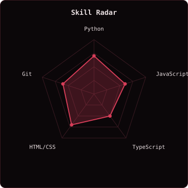
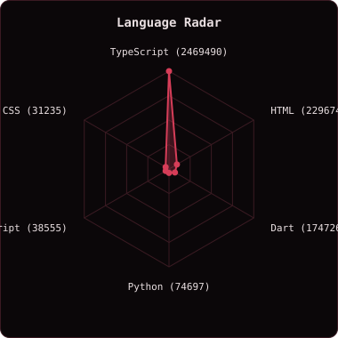
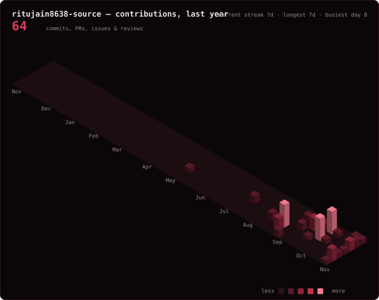
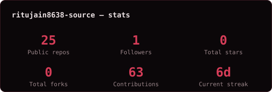

  

  

  
  
   
  

## `~/` whoami

Hi, I'm **Samyak Jain**.

- First-year student exploring how technology works & building new things
- Currently working on [food with health](https://github.com/ritujain8638-source/New-beginning-)
- Learning **Python, JavaScript, and TypeScript**
- Reach me at **ritujain8638@gmail.com**

## `~/` toolbox

## `~/` skill radar

One I rated myself (edit `config.json`). The other counts real language bytes across my public repos and redraws itself on a schedule.

<table>
  <tr>
    <td></td>
    <td></td>
  </tr>
</table>

## `~/` contribution calendar

## `~/` the numbers

everything above regenerates itself on a schedule — nothing here is hand-updated

